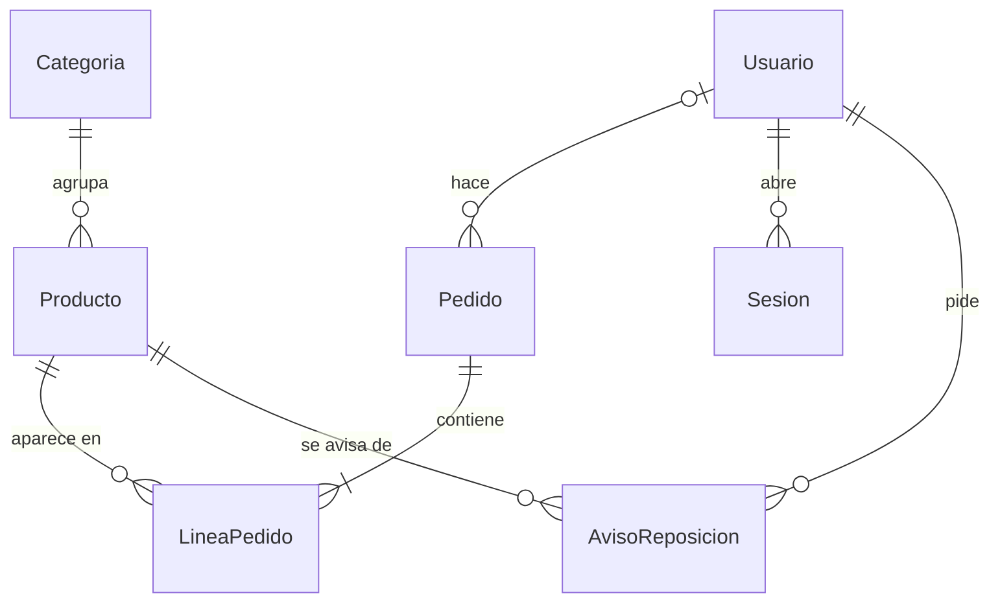

# El Rincón de las Flores · floristería online con Next.js, Stripe y Neon

**Resumen:** tienda online de una floristería de barrio. El cliente busca ramos y centros de mesa por ocasión,
los añade al carrito, indica a quién y dónde se entregan (los gastos de envío dependen del código postal) y paga con
Stripe. El pago se confirma por webhook, se descuenta el stock y le llega un email. La floristería gestiona los
pedidos y los productos desde un panel privado. Desplegada en Vercel, con base de datos en Neon y CI en GitHub Actions.

**Demo:** https://exercise2-floristeria.vercel.app (Stripe en modo test: usa la tarjeta `4242 4242 4242 4242`, cualquier fecha futura y
cualquier CVC; no se cobra nada)

> Proyecto final del Master Desarrollo Agéntico (The Power), adaptado de la plantilla Tienda Volta del curso.


## Cómo comprobar cada requisito

| Requisito | Cómo verlo en la demo | Dónde está en el código |
|---|---|---|
| **Modelo de datos correcto** | — | `prisma/schema.prisma` y migraciones en `prisma/migrations/` (ver [Modelo de datos](#modelo-de-datos)) |
| **Catálogo con búsqueda y filtros** | En `/` busca "peonias" (encuentra "peonías"), filtra por ocasión y precio y ordena. La búsqueda queda en la URL | `src/app/page.tsx`, `src/components/filtros.tsx`, `src/lib/catalogo.ts`, `src/lib/catalogo-where.ts`, `src/lib/busqueda.ts` |
| **Carrito persistente** | Añade productos, recarga o cierra el navegador: el carrito sigue ahí. Al entrar con tu cuenta, lo que tenías sin sesión se suma | `src/store/carrito.ts` (Zustand + `persist`), `src/components/sincronizar-carrito.tsx` |
| **Checkout con Stripe y pago de prueba** | Crea una cuenta, pulsa "Pagar", rellena la entrega (prueba el CP `08201`) y paga con `4242 4242 4242 4242` | `src/app/checkout/actions.ts`, `src/lib/pago.ts`, `src/lib/stripe.ts` |
| **Webhook de confirmación de pago** | Tras pagar, `/checkout/exito` pasa a "Pago confirmado" y el pedido aparece como PAGADO en "Mis pedidos" y en el admin | `src/app/api/webhooks/stripe/route.ts` |
| **Emails vía Resend** | Llega un email de confirmación con las líneas, la entrega y el total (sin dominio propio, Resend solo entrega a la dirección de la cuenta de Resend) | `src/lib/email.ts`, `src/lib/plantilla-email.ts` |
| **Panel de administrador** | Entra con la cuenta de administrador en `/admin`: filtra pedidos por estado, abre uno y avánzalo (pagado → enviado → entregado) | `src/app/admin/`, `src/lib/estados.ts` |
| **Aplicación desplegada** | https://exercise2-floristeria.vercel.app | Vercel (deploy en cada push a `main`), `.github/workflows/ci.yml` |

**Acceso de administrador:** las cuentas de administrador no se pueden crear desde la web (se crean con
`npm run crear-admin`). Las credenciales de una cuenta de demo se facilitan aparte, junto con la entrega; no están en
el repositorio.

## Qué tiene la aplicación

### Pantallas

| Ruta | Qué hace |
|---|---|
| `/` | **Catálogo** de 10 ramos y centros en 4 ocasiones (Amor, Celebraciones, Condolencias, Para casa), con búsqueda por nombre (sin distinguir tildes ni mayúsculas: "peonias" encuentra "peonías"), filtros de ocasión y precio, y orden por precio o nombre. Todo se resuelve en el servidor y vive en la URL, así que cualquier búsqueda se puede compartir. |
| `/producto/[id]` | **Ficha** con ilustración, descripción, precio y stock. "Añadir al carrito" vuelve al catálogo; "Pagar ahora" lleva a pagar todo el carrito. Si está agotado, "Avísame cuando vuelva". Si el producto no existe o está oculto, su propia 404. |
| `/carrito` | **Carrito**: cambiar cantidades, quitar productos y total. Sobrevive a recargar y a cerrar el navegador, con un carrito por cuenta. |
| `/entrar` y `/registro` | **Cuentas** con email y contraseña (scrypt, sesión en una cookie `httpOnly`). Entrar es opcional para mirar, obligatorio para pagar. |
| `/checkout/envio` | **Entrega**: destinatario, teléfono, dirección, código postal, ciudad y mensaje para la tarjeta. Muestra los gastos de envío según el CP y cuánto falta para el envío gratis. |
| Botón "Pagar" | **Checkout** con una Server Action: crea el pedido PENDIENTE releyendo precios, stock y envío de la base de datos (nunca del navegador) y redirige a la página de pago de Stripe. |
| `/checkout/exito` | Muestra el pedido y su estado. Dice "Pago confirmado" solo cuando el webhook ya lo ha marcado como pagado; si aún no, lo dice con honestidad. |
| `/checkout/cancelado` | El cliente volvió sin pagar: no se cobra nada y el carrito sigue guardado. |
| `/cuenta/pedidos` | **Mis pedidos**: historial del cliente y detalle de cada pedido con su entrega (los de otra cuenta dan 404). |
| `/cuenta/avisos` | **Mis avisos de reposición**: los pendientes (se pueden quitar) y los enviados en los últimos 30 días. |
| `/admin` | **Pedidos** (solo rol ADMIN): lista filtrada por estado (toda la fila abre el pedido) y ficha de cada pedido con su entrega para avanzarlo (pagado → enviado → entregado) o cancelar uno que se quedó sin pagar. |
| `/admin/productos` | **Productos** (solo rol ADMIN): editar nombre, descripción, precio y categoría; ocultar o mostrar; reponer stock o corregirlo; ver cuántos avisos de reposición hay pendientes. |
| Cualquier otra ruta | 404 general: "No encontramos esa página", con enlace al catálogo. |

### Gastos de envío por código postal

Las tarifas están en un único sitio, `TARIFAS_ENVIO` (`src/lib/envio.ts`), en céntimos:

| Zona | Códigos postales | Coste | Gratis desde |
|---|---|---|---|
| Reparto en Sabadell | 08201 a 08208 | 3,90 € | 40 € |
| Mensajería · provincia de Barcelona | resto de 08xxx | 6,90 € | 70 € |
| Mensajería 24 h · península | resto de España peninsular | 9,90 € | sin envío gratis |
| Sin envío | Baleares (07), Canarias (35, 38), Ceuta (51), Melilla (52) | — | — |

El formulario solo enseña una vista previa; el envío que se cobra lo recalcula el servidor con los precios de la base
de datos. El pedido guarda una copia de la entrega, la zona y los gastos de envío, y su `total` ya los incluye: si
mañana cambia una tarifa, los pedidos antiguos no cambian.

### Lo que pasa por detrás

- **Webhook firmado de Stripe**: el único punto que marca un pedido como PAGADO, descuenta el stock y envía el email.
  Es idempotente (un evento repetido no descuenta dos veces). Si el pago se abandona y la sesión de Stripe caduca,
  el mismo webhook cancela el pedido.
- **Email de confirmación** con Resend: número de pedido, líneas, entrega, gastos de envío y total.
- **Avisos de reposición**: cuando el admin repone un producto agotado, los clientes que lo pidieron reciben un email
  (una sola vez, por lotes, y los que fallan se reintentan en la siguiente reposición).
- **Productos ocultos** en lugar de borrados: desaparecen del catálogo y del checkout, pero los pedidos antiguos los
  siguen viendo.
- **Ilustraciones propias** en SVG para cada producto: sin fotos ni licencias de terceros.
- **Tests** con Vitest: reglas de negocio (estados, envíos, pago, avisos, cuentas, contraseñas, carrito, búsqueda),
  datos del catálogo, ilustraciones, marca y contraste de colores.

## Modelo de datos



| Tabla | Para qué | Campos clave |
|---|---|---|
| `Categoria` | Ocasiones del catálogo | `nombre`, `slug` (para la URL) |
| `Producto` | Ramos y centros | `precio` (céntimos), `stock`, `visible`, `nombreBusqueda` (sin tildes, para buscar) |
| `Pedido` | Una compra | `estado` (PENDIENTE, PAGADO, ENVIADO, ENTREGADO, CANCELADO), `total` y `gastosEnvio` (céntimos), `stripeSessionId`, datos de entrega (`envioNombre`, `envioCp`, `envioZona`…), `usuarioId` |
| `LineaPedido` | Producto y cantidad de un pedido | `precioUnitario` copiado al comprar (si el precio cambia, el pedido no) |
| `Usuario` | Cliente o administrador | `email` único, `contrasena` (hash scrypt), `rol` (CLIENTE o ADMIN) |
| `Sesion` | Sesión iniciada | `id` = SHA-256 del token de la cookie, `caduca` |
| `AvisoReposicion` | "Avísame cuando vuelva" | uno por cliente y producto, `enviadoEn` (nulo = pendiente) |

## Servicios externos

| Servicio | Para qué | Cuándo se llama | Desde dónde | Variables |
|---|---|---|---|---|
| **Neon** (PostgreSQL) | Toda la base de datos (rama `main` para producción y `desarrollo` para local) | En cada página, en el checkout, en el webhook y en el admin | `src/lib/prisma.ts` (Prisma con driver adapter `pg`) | `DATABASE_URL` (con pooler, la app), `DIRECT_URL` (directa, las migraciones) |
| **Stripe Checkout** | Cobrar en una página de pago alojada por Stripe | Al pulsar "Pagar": se crea una sesión con las líneas, el envío y el `pedidoId` en `metadata` | `src/app/checkout/actions.ts` vía `src/lib/stripe.ts` | `STRIPE_SECRET_KEY` (solo `sk_test_`), `NEXT_PUBLIC_STRIPE_PUBLISHABLE_KEY` |
| **Webhook de Stripe** (entrante) | Que Stripe avise de `checkout.session.completed` y `checkout.session.expired` | Stripe llama a la tienda tras cada pago o caducidad | `src/app/api/webhooks/stripe/route.ts` | `STRIPE_WEBHOOK_SECRET` (verifica la firma) |
| **Resend** | Email de confirmación del pedido y avisos de reposición | Desde el webhook (pago) y al reponer stock en el admin (avisos) | `src/lib/email.ts`, `src/lib/reposicion.ts` | `RESEND_API_KEY`, `EMAIL_PRUEBAS` (sin dominio propio, todos los emails van ahí) |
| **Google Fonts** | Fuentes Geist (texto) y Fraunces (títulos) | Solo al compilar: `next/font` las descarga y las sirve la propia web | `src/app/layout.tsx` | — |
| **Vercel** | Alojamiento y despliegue automático en cada push a `main` | Siempre (hosting) | — | Las de arriba |
| **GitHub Actions** | CI: lint, tipos, tests y build en cada push | En cada push | `.github/workflows/ci.yml` | Claves ficticias: no se conecta a nada |

El navegador del cliente solo habla con la tienda y con la página de pago de Stripe: ninguna clave secreta sale del servidor.

## Stack

| Capa | Tecnología |
|---|---|
| Framework | Next.js 15 (App Router, Server Components, Server Actions) + TypeScript |
| UI | Tailwind CSS 4 + shadcn/ui (Base UI), Geist y Fraunces |
| Estado del carrito | Zustand 5 + persist |
| Base de datos | PostgreSQL en Neon + Prisma 7 (driver adapter pg) |
| Pagos | Stripe Checkout + webhooks (modo test) |
| Emails | Resend |
| Calidad | ESLint, TypeScript estricto, Vitest, GitHub Actions |
| Despliegue | Vercel (deploy automático en cada push a main) |

## Decisiones de diseño

1. **Precios en céntimos** (enteros) en la base de datos y en Stripe: sin errores de coma flotante.
2. **El pedido se confirma en el webhook, no en la página de éxito**: si el cliente cierra el navegador tras pagar, el
   pedido se confirma igual. La página de éxito solo lee y cuenta el estado.
3. **Nada que venga del navegador es fiable**: el checkout recibe ids, cantidades y la entrega, y recalcula precios,
   stock y envío.
4. **Idempotencia**: el webhook solo cambia pedidos en PENDIENTE; un evento repetido no descuenta stock dos veces.
5. **Secretos solo en el servidor**: `server-only` en `lib/stripe.ts` y `lib/email.ts`; cada Server Action del admin
   vuelve a comprobar la sesión y el rol en la base de datos (el middleware protege páginas, no acciones).
6. **El pedido es una foto**: copia precios, entrega y gastos de envío al crearse; cambiar el catálogo o las tarifas
   no altera pedidos ya hechos.
7. **La marca en un solo sitio**: el nombre está en `src/lib/tienda.ts` y los colores en `src/app/globals.css`.

Más detalle (por qué algo es así y qué tocar para cambiarlo) en `docs/NOTAS-DEL-PROYECTO.md`.

## Ejecutarlo en local

Necesitas Node.js 20+, una base PostgreSQL en [Neon](https://neon.tech) (vale el plan gratuito), una cuenta de Stripe
en modo test, la [Stripe CLI](https://github.com/stripe/stripe-cli) y una cuenta de Resend.

En Neon, usa **una rama para desarrollo** (*Branches › Create branch*, a partir de `main`) y pon sus URLs en el
`.env`: así lo que hagas en local no toca la tienda publicada. `npm run db:check` te dice si estás en desarrollo o en
producción.

```bash
npm install                 # dependencias + cliente de Prisma
cp .env.example .env        # y rellena los valores
npx prisma migrate deploy   # crea las tablas
npm run seed                # 4 ocasiones y 10 ramos y centros (borra pedidos, usuarios y sesiones)
npm run crear-admin -- tu@email.com   # tu cuenta de administrador (pide la contraseña)
npm run dev                 # http://localhost:3000
# en otra terminal: reenviar los eventos de Stripe al webhook local
stripe listen --events checkout.session.completed,checkout.session.expired --forward-to localhost:3000/api/webhooks/stripe
```

Comprobaciones útiles: `npm run db:check`, `npm run stripe:check`, `npx tsx scripts/ver-pedidos.ts`,
`npx tsx scripts/ver-sql-catalogo.ts` (el SQL que genera una búsqueda), `npm test`.

**Migraciones en producción:** Vercel no las aplica. Crea un `.env.produccion` (ignorado por git) con el
`DATABASE_URL` y el `DIRECT_URL` de la rama `main` y ejecuta `npm run migrar:produccion` **antes** de hacer push del
código que necesita la migración.

## Desplegarlo en Vercel

1. Importa el repositorio en Vercel (Next.js se detecta solo; `postinstall` genera el cliente de Prisma).
2. Variables de entorno: `DATABASE_URL`, `DIRECT_URL`, `STRIPE_SECRET_KEY`, `NEXT_PUBLIC_STRIPE_PUBLISHABLE_KEY`,
   `RESEND_API_KEY`, `EMAIL_PRUEBAS`.
3. En Stripe (Workbench > Webhooks > Add destination): eventos `checkout.session.completed` y `checkout.session.expired`,
   y URL `https://TU-DOMINIO/api/webhooks/stripe`. Copia su signing secret como `STRIPE_WEBHOOK_SECRET` en Vercel y
   redespliega. Ese secreto es distinto del que imprime `stripe listen` en local.
4. Comprueba que las claves de Stripe en Vercel son las de **test** (`sk_test_`, `pk_test_`): con una `sk_live_` la
   tienda se niega a arrancar el pago, a propósito.
5. Aplica las migraciones y crea el administrador en la base de producción: `npm run migrar:produccion` y después
   `npm run crear-admin -- <email> --produccion` (pide la contraseña).
6. Usa el dominio de producción (`*.vercel.app` sin hash): las URLs de cada despliegue están protegidas por Vercel.

## Estructura

```
src/app/                 páginas: catálogo, producto/[id], carrito, entrar, registro, cuenta (pedidos, avisos),
                         checkout (envío, éxito, cancelado), admin (pedidos, productos)
src/app/**/actions.ts    Server Actions: checkout, entrar/salir, avisos, estados de pedido, productos del admin
src/app/api/webhooks/    webhook de Stripe (la única API route)
src/components/          cabecera, tarjetas, filtros, carrito, formularios (entrega, cuenta, productos) y ui/ de shadcn
src/lib/                 tienda (nombre), prisma, stripe, email, catálogo y búsqueda, envío (tarifas), pago,
                         estados, avisos y reposición, cuentas, contraseñas, sesión, formato
src/store/carrito.ts     carrito con Zustand + persist
src/middleware.ts        exige la cookie de sesión en /admin y /cuenta
prisma/                  schema, migraciones, datos del catálogo y seed
scripts/                 crear-admin y comprobaciones (base de datos, Stripe, pedidos, SQL)
public/productos/        ilustraciones SVG de los productos
tests/                   tests de reglas de negocio y de datos (Vitest)
.github/workflows/ci.yml lint + tipos + tests + build en cada push
```

## Cómo se hizo

El proyecto se desarrolló con **Claude Code** como asistente, trabajando por funcionalidades: primero una conversación
para decidir qué construir, después un documento de diseño, un plan por tareas con sus tests y, al final, una
revisión del código antes de fusionar. Todo ese rastro está en el repositorio:

- `docs/superpowers/specs/`: los documentos de diseño de cada funcionalidad (la tienda, las cuentas, el admin de
  productos, los envíos por código postal y los avisos de reposición).
- `docs/superpowers/plans/`: el plan de implementación de cada una, tarea a tarea.
- `CLAUDE.md`: el contexto y las reglas que el asistente lee antes de tocar el código.
- `docs/ESPECIFICACION.md` y `docs/NOTAS-DEL-PROYECTO.md`: qué hace la tienda y por qué está hecha así.

Tienda de demostración: los pagos están en modo test y no se cobra nada.
