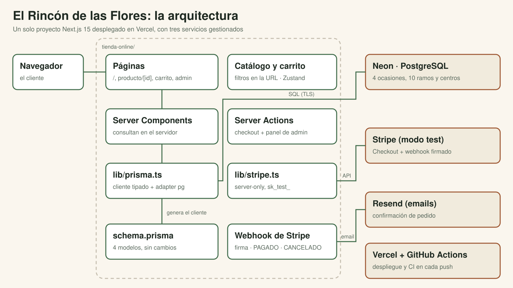

# El Rincón de las Flores · floristería online con Next.js, Stripe y Neon

**Resumen:** tienda online de una floristería de barrio. El cliente busca ramos y centros de mesa por ocasión,
los añade al carrito y paga con Stripe; el pago se confirma por webhook, se descuenta el stock y le llega un email.
La floristería gestiona los pedidos desde un panel privado. Desplegada en Vercel, con base de datos en Neon y CI en GitHub Actions.

**Demo:** https://exercise2-floristeria.vercel.app (Stripe en modo test: usa la tarjeta `4242 4242 4242 4242`, cualquier fecha futura y
cualquier CVC; no se cobra nada)

> Proyecto final del Master Desarrollo Agéntico (The Power), adaptado de la plantilla Tienda Volta del curso.



## Qué tiene la aplicación

### Pantallas

| Ruta | Qué hace |
|---|---|
| `/` | **Catálogo** de 10 ramos y centros en 4 ocasiones (Amor, Celebraciones, Condolencias, Para casa), con búsqueda por nombre (sin distinguir tildes ni mayúsculas: "peonias" encuentra "peonías"), filtros de ocasión y precio, y orden por precio o nombre. Todo se resuelve en el servidor y vive en la URL, así que cualquier búsqueda se puede compartir. |
| `/producto/[id]` | **Ficha** con ilustración, descripción, precio, stock y distintivo de "Agotado" (botón desactivado). Si el producto no existe, su propia 404: "No encontramos ese producto". |
| `/carrito` | **Carrito** con Zustand: cambiar cantidades, quitar productos y total. Sobrevive a recargar y a cerrar el navegador (localStorage). |
| Botón "Pagar" | **Checkout** con una Server Action: crea el pedido PENDIENTE releyendo precios y stock de la base de datos (nunca del navegador) y redirige a la página de pago de Stripe. |
| `/checkout/exito` | Muestra el pedido y su estado. Dice "Pago confirmado" solo cuando el webhook ya lo ha marcado como pagado; si aún no, lo dice con honestidad. |
| `/checkout/cancelado` | El cliente volvió sin pagar: no se cobra nada y el carrito sigue guardado. |
| Cualquier otra ruta | 404 general: "No encontramos esa página", con enlace al catálogo. |
| `/admin` | **Panel de la floristería**, con contraseña: pedidos filtrados por estado (toda la fila abre el pedido) y ficha de cada pedido para avanzarlo (pagado → enviado → entregado) o cancelar uno que se quedó sin pagar. |

### Lo que pasa por detrás

- **Webhook firmado de Stripe**: el único punto que marca un pedido como PAGADO, descuenta el stock y envía el email.
  Es idempotente (un evento repetido no descuenta dos veces). Si el pago se abandona y la sesión de Stripe caduca,
  el mismo webhook cancela el pedido.
- **Email de confirmación** con Resend, con el número de pedido, las líneas y el total.
- **Ilustraciones propias** en SVG para cada producto: sin fotos ni licencias de terceros.
- **Tests** de las reglas de negocio, de los datos del catálogo, de la marca y del contraste de colores (Vitest).

## Servicios externos

| Servicio | Para qué | Cuándo se llama | Desde dónde | Variables |
|---|---|---|---|---|
| **Neon** (PostgreSQL) | Productos, categorías y pedidos (rama `main` para producción y `desarrollo` para local) | En cada página del catálogo, en el checkout, en el webhook y en el admin | `src/lib/prisma.ts` (Prisma con driver adapter `pg`) | `DATABASE_URL` (con pooler, la app), `DIRECT_URL` (directa, las migraciones) |
| **Stripe Checkout** | Cobrar en una página de pago alojada por Stripe | Al pulsar "Pagar": se crea una sesión con las líneas y el `pedidoId` en `metadata` | `src/app/checkout/actions.ts` vía `src/lib/stripe.ts` | `STRIPE_SECRET_KEY` (solo `sk_test_`), `NEXT_PUBLIC_STRIPE_PUBLISHABLE_KEY` |
| **Webhook de Stripe** (entrante) | Que Stripe avise de `checkout.session.completed` y `checkout.session.expired` | Stripe llama a la tienda tras cada pago o caducidad | `src/app/api/webhooks/stripe/route.ts` | `STRIPE_WEBHOOK_SECRET` (verifica la firma) |
| **Resend** | Email de confirmación del pedido | Solo desde el webhook, tras marcar el pedido como pagado | `src/lib/email.ts` | `RESEND_API_KEY`, `EMAIL_PRUEBAS` (sin dominio propio, todos los emails van ahí) |
| **Google Fonts** | Fuentes Geist (texto) y Fraunces (títulos) | Solo al compilar: `next/font` las descarga y las sirve la propia web | `src/app/layout.tsx` | — |
| **Vercel** | Alojamiento y despliegue automático en cada push a `main` | Siempre (hosting) | — | Las de arriba, más `ADMIN_PASSWORD` |
| **GitHub Actions** | CI: lint, tipos, tests y build en cada push | En cada push | `.github/workflows/ci.yml` | Claves ficticias: no se conecta a nada |

El navegador del cliente solo habla con la tienda y con la página de pago de Stripe: ninguna clave secreta sale del servidor.

## Stack

| Capa | Tecnología |
|---|---|
| Framework | Next.js 15 (App Router, Server Components, Server Actions) + TypeScript |
| UI | Tailwind CSS 4 + shadcn/ui (Base UI), Geist y Fraunces |
| Estado del carrito | Zustand 5 + persist |
| Base de datos | PostgreSQL en Neon + Prisma 7 (driver adapter pg) |
| Pagos | Stripe Checkout + webhooks (modo test) |
| Emails | Resend |
| Calidad | ESLint, TypeScript estricto, Vitest, GitHub Actions |
| Despliegue | Vercel (deploy automático en cada push a main) |

## Decisiones de diseño

1. **Precios en céntimos** (enteros) en la base de datos y en Stripe: sin errores de coma flotante.
2. **El pedido se confirma en el webhook, no en la página de éxito**: si el cliente cierra el navegador tras pagar, el
   pedido se confirma igual. La página de éxito solo lee y cuenta el estado.
3. **Nada que venga del navegador es fiable**: el checkout recibe ids y cantidades y recalcula precios y stock.
4. **Idempotencia**: el webhook solo cambia pedidos en PENDIENTE; un evento repetido no descuenta stock dos veces.
5. **Secretos solo en el servidor**: `server-only` en `lib/stripe.ts` y `lib/email.ts`; cada Server Action del admin
   vuelve a comprobar la sesión (el middleware protege páginas, no acciones).
6. **La marca en un solo sitio**: el nombre está en `src/lib/tienda.ts` y los colores en `src/app/globals.css`.

Más detalle (por qué algo es así y qué tocar para cambiarlo) en `docs/NOTAS-DEL-PROYECTO.md`.

## Ejecutarlo en local

Necesitas Node.js 20+, una base PostgreSQL (Neon free tier o `docker compose up -d`), una cuenta de Stripe en modo test,
la [Stripe CLI](https://github.com/stripe/stripe-cli) y una cuenta de Resend.

Con Neon, usa **una rama para desarrollo** (*Branches › Create branch*, a partir de `main`) y pon sus URLs en el
`.env`: así lo que hagas en local no toca la tienda publicada. `npm run db:check` te dice si estás en desarrollo o en
producción.

```bash
npm install                 # dependencias + cliente de Prisma
cp .env.example .env        # y rellena los valores
npx prisma migrate deploy   # crea las tablas
npm run seed                # 4 ocasiones y 10 ramos y centros (borra los pedidos)
npm run dev                 # http://localhost:3000
# en otra terminal: reenviar los eventos de Stripe al webhook local
stripe listen --events checkout.session.completed,checkout.session.expired --forward-to localhost:3000/api/webhooks/stripe
```

Comprobaciones útiles: `npm run db:check`, `npm run stripe:check`, `npx tsx scripts/ver-pedidos.ts`, `npm test`.

**Migraciones en producción:** Vercel no las aplica. Crea un `.env.produccion` (ignorado por git) con el
`DATABASE_URL` y el `DIRECT_URL` de la rama `main` y ejecuta `npm run migrar:produccion` **antes** de hacer push del
código que necesita la migración.

## Desplegarlo en Vercel

1. Importa el repositorio en Vercel (Next.js se detecta solo; `postinstall` genera el cliente de Prisma).
2. Variables de entorno: `DATABASE_URL`, `DIRECT_URL`, `STRIPE_SECRET_KEY`, `NEXT_PUBLIC_STRIPE_PUBLISHABLE_KEY`,
   `RESEND_API_KEY`, `EMAIL_PRUEBAS`, `ADMIN_PASSWORD`.
3. En Stripe (Workbench > Webhooks > Add destination): eventos `checkout.session.completed` y `checkout.session.expired`,
   y URL `https://TU-DOMINIO/api/webhooks/stripe`. Copia su signing secret como `STRIPE_WEBHOOK_SECRET` en Vercel y
   redespliega. Ese secreto es distinto del que imprime `stripe listen` en local.
4. Comprueba que las claves de Stripe en Vercel son las de **test** (`sk_test_`, `pk_test_`): con una `sk_live_` la
   tienda se niega a arrancar el pago, a propósito.
5. Usa el dominio de producción (`*.vercel.app` sin hash): las URLs de cada despliegue están protegidas por Vercel.

## Estructura

```
src/app/                 páginas: catálogo, producto/[id], carrito, checkout (éxito/cancelado), admin
src/app/checkout/        Server Action del checkout
src/app/api/webhooks/    webhook de Stripe (la única API route)
src/components/          cabecera, logo, tarjetas, filtros, carrito, admin (y ui/ de shadcn)
src/lib/                 tienda (nombre), prisma, stripe, email, catálogo, orden, estados, admin, formato
src/store/carrito.ts     carrito con Zustand + persist
prisma/                  schema, migraciones, datos del catálogo y seed
public/productos/        ilustraciones SVG de los productos
tests/                   tests de reglas de negocio y de datos (Vitest)
.github/workflows/ci.yml lint + tipos + tests + build en cada push
```

Tienda de demostración: los pagos están en modo test y no se cobra nada.
